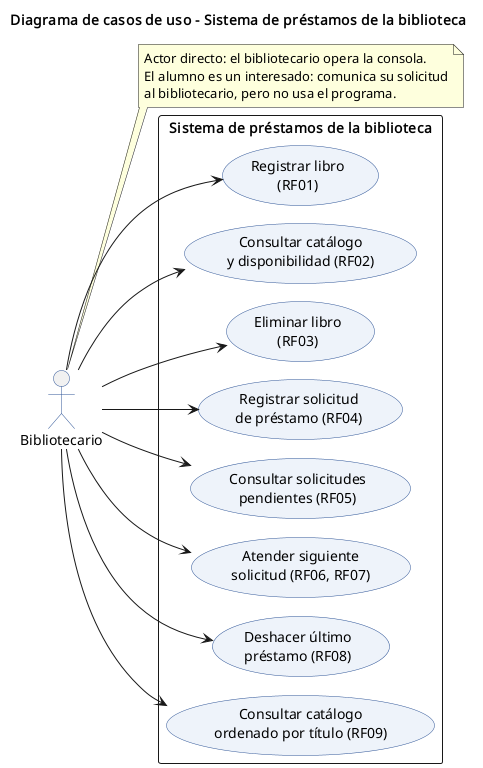
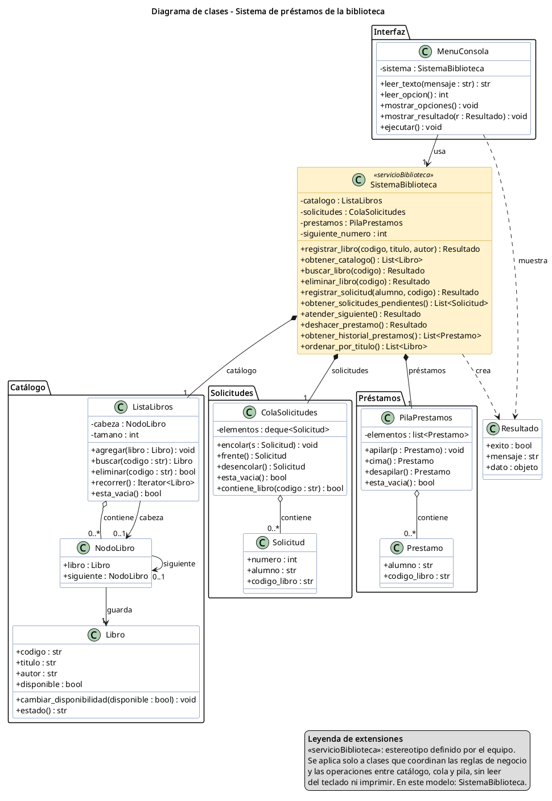
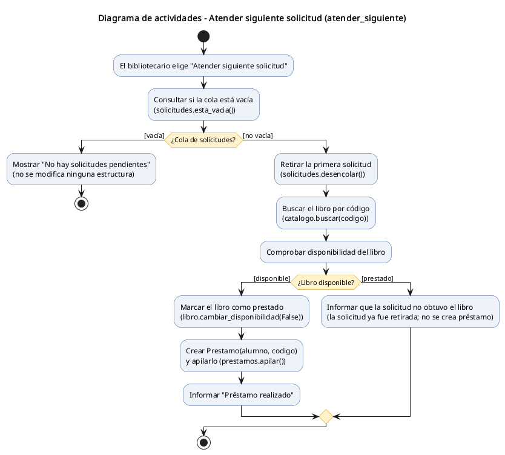
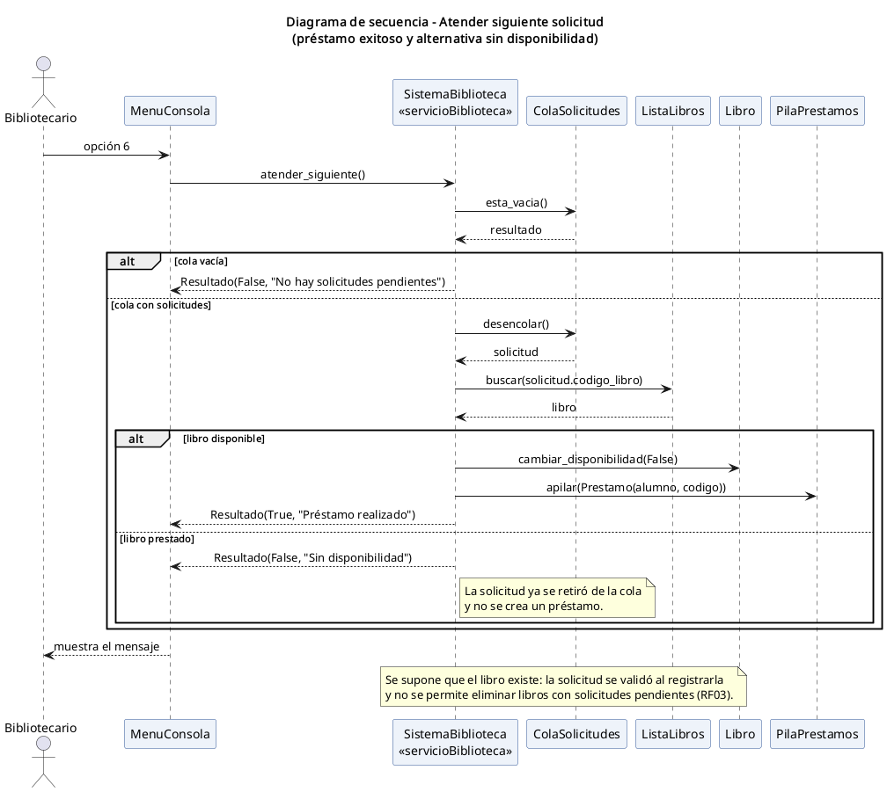
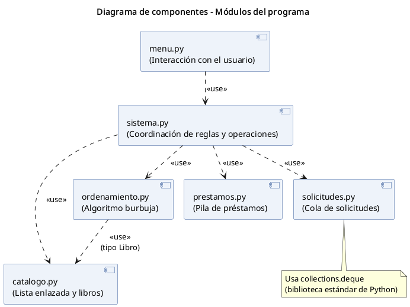
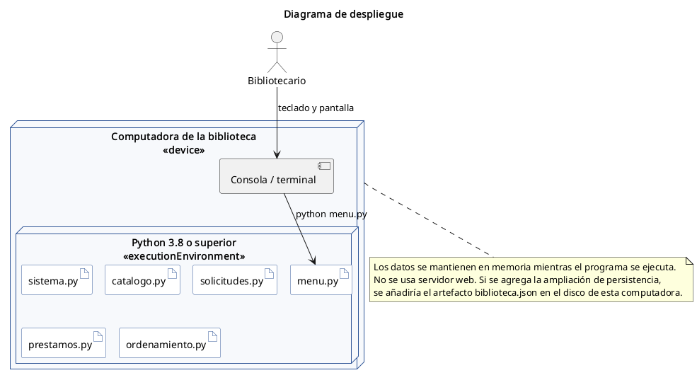
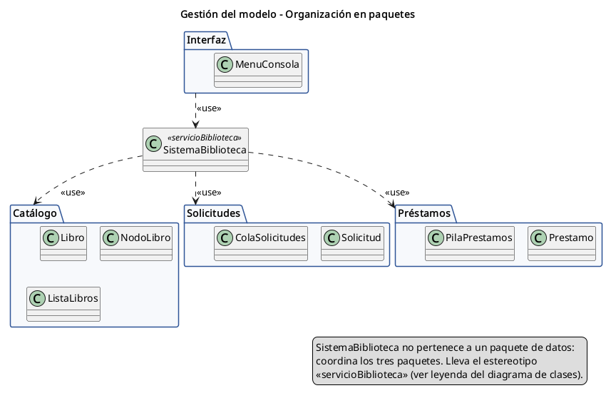

# 5. Modelado UML

## 5.1 Qué es UML

UML (Lenguaje Unificado de Modelado) permite representar y documentar la estructura y el comportamiento de un sistema. Es un lenguaje de modelado, no una metodología de desarrollo ni un lenguaje de programación, y se puede usar con enfoques tradicionales o ágiles [6, 7].

Los diagramas se escribieron en **PlantUML** (archivos `.puml` en la carpeta `diagramas/`) y se exportaron a PNG. Para editarlos se puede pegar el contenido de un `.puml` en https://www.plantuml.com/plantuml.

## 5.2 Áreas estudiadas

| Área | Qué representa | Aplicación en la biblioteca | Diagramas |
|---|---|---|---|
| Estructural | Elementos del sistema y sus relaciones | Libros, nodos, catálogo y componentes | Clases, componentes, despliegue |
| Dinámica o de comportamiento | Acciones, decisiones e interacciones | Atender solicitudes y deshacer préstamos | Casos de uso, actividades, secuencia |
| Gestión del modelo | Organización de los elementos del modelo | Paquetes Catálogo, Solicitudes, Préstamos e Interfaz | Paquetes |
| Extensiones | Adaptaciones controladas mediante estereotipos | Estereotipo «servicioBiblioteca» | Clases, paquetes, secuencia |

## 5.3 Diagrama de casos de uso

El bibliotecario está fuera del límite del sistema y se relaciona con los ocho casos de uso (cada uno indica su requerimiento). El alumno no aparece como actor porque no opera la consola. Las acciones internas como `desencolar()` o `pop()` no aparecen como casos de uso: son pasos internos, no objetivos del usuario.

## 5.4 Diagrama de clases

Relaciones representadas:
- `ListaLibros` contiene 0..* nodos y apunta a 0..1 nodo cabeza.
- Cada `NodoLibro` guarda exactamente un `Libro` y se enlaza con 0..1 nodo siguiente.
- `ColaSolicitudes` contiene 0..* `Solicitud`; `PilaPrestamos` contiene 0..* `Prestamo`.
- `SistemaBiblioteca` se compone de un catálogo, una cola y una pila, y crea objetos `Resultado`.
- `MenuConsola` usa `SistemaBiblioteca`.

El diseño respeta la propuesta del proyecto: `NodoLibro` guarda un objeto `Libro` (no copia sus campos).

## 5.5 Diagrama de actividades: Atender siguiente solicitud

Tiene nodo de inicio, acciones, dos decisiones con guardas `[vacía]` / `[no vacía]` y `[disponible]` / `[prestado]`, y nodos de fin. Corresponde paso a paso con `SistemaBiblioteca.atender_siguiente()`.

## 5.6 Diagrama de secuencia

Muestra el escenario de préstamo exitoso y la alternativa sin disponibilidad con fragmentos `alt`. Se apila un préstamo **solo** en la rama `[libro disponible]`; el código y la prueba P20 respetan esa condición.

## 5.7 Diagrama de componentes

| Componente | Responsabilidad |
|---|---|
| menu.py | Interacción con el usuario |
| sistema.py | Coordinación de reglas y operaciones |
| catalogo.py | Lista enlazada y libros |
| solicitudes.py | Cola de solicitudes |
| prestamos.py | Pila de préstamos |
| ordenamiento.py | Algoritmo burbuja |

El menú depende solo del sistema y el sistema usa los demás componentes. `ordenamiento.py` también depende de `catalogo.py` porque recibe objetos `Libro`. Estas dependencias son exactamente los `import` de cada archivo.

## 5.8 Diagrama de despliegue

Nodo físico: computadora de la biblioteca. Entorno de ejecución: Python 3.8 o superior. Artefactos: los seis archivos `.py`. No hay servidor web. Si se agrega la ampliación de persistencia, se añadiría `biblioteca.json` en el disco de la misma computadora.

## 5.9 Gestión del modelo: paquetes

| Paquete | Elementos | Archivo |
|---|---|---|
| Catálogo | Libro, NodoLibro, ListaLibros | catalogo.py |
| Solicitudes | Solicitud, ColaSolicitudes | solicitudes.py |
| Préstamos | Prestamo, PilaPrestamos | prestamos.py |
| Interfaz | MenuConsola (menú y entrada de datos) | menu.py |

`SistemaBiblioteca` (sistema.py) queda fuera de los paquetes de datos porque coordina a los tres.

## 5.10 Ejercicio de extensiones: estereotipo «servicioBiblioteca»

**Definición (leyenda):** «servicioBiblioteca» es un estereotipo definido por el equipo que se aplica a **clases**. Marca la clase que coordina las reglas de negocio y las operaciones entre catálogo, cola y pila.

**Condiciones para aplicarlo:**
1. La clase aplica las reglas R1 a R5.
2. La clase usa al menos dos de las estructuras (lista, cola, pila).
3. La clase no lee del teclado ni imprime; devuelve resultados a la interfaz.

**Elemento al que se aplica:** `SistemaBiblioteca`. No se aplica a `MenuConsola` (lee y muestra datos) ni a las estructuras (cada una administra solo sus propios elementos).

**Dónde aparece:** diagrama de clases (con color distinto y leyenda), diagrama de paquetes y participante del diagrama de secuencia. En el código, el docstring de `SistemaBiblioteca` lo indica.

Un perfil UML formal, con metaclase extendida y propiedades etiquetadas, sería una ampliación de este ejercicio.

## 5.11 Validación de congruencia entre diagramas y código

| Elemento del modelo | Comprobación en el código | ¿Congruente? |
|---|---|---|
| Ocho casos de uso | Ocho opciones de menú (1-8) más Salir | Sí |
| 8 clases mínimas + MenuConsola + Resultado | Existen con los mismos atributos y métodos | Sí |
| Decisiones del diagrama de actividades | `if` de `atender_siguiente()` en el mismo orden | Sí |
| Mensajes del diagrama de secuencia | `esta_vacia()`, `desencolar()`, `buscar()`, `cambiar_disponibilidad()`, `apilar()` | Sí |
| Dependencias de componentes | `import` de cada módulo | Sí |
| Artefactos de despliegue | Seis archivos `.py` en `programa/` | Sí |
